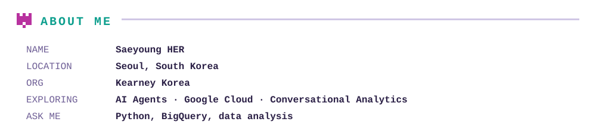
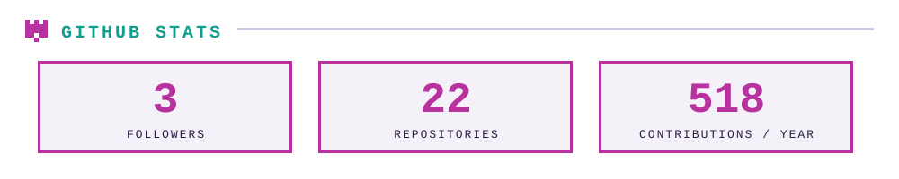

<picture><source media="(prefers-color-scheme: dark)" srcset="assets/hero-dark.svg"><source media="(prefers-color-scheme: light)" srcset="assets/hero-light.svg"></picture>

<picture><source media="(prefers-color-scheme: dark)" srcset="assets/player-card-dark.svg"><source media="(prefers-color-scheme: light)" srcset="assets/player-card-light.svg"></picture>

<picture><source media="(prefers-color-scheme: dark)" srcset="assets/about-dark.svg"><source media="(prefers-color-scheme: light)" srcset="assets/about-light.svg"></picture>

<picture><source media="(prefers-color-scheme: dark)" srcset="assets/working-head-dark.svg"><source media="(prefers-color-scheme: light)" srcset="assets/working-head-light.svg"></picture>
<a href="https://github.com/SYHER/adk-docs"><picture><source media="(prefers-color-scheme: dark)" srcset="assets/quest-adk-dark.svg"><source media="(prefers-color-scheme: light)" srcset="assets/quest-adk-light.svg"></picture></a>
<a href="https://github.com/SYHER/ca-api-bq"><picture><source media="(prefers-color-scheme: dark)" srcset="assets/quest-ca-dark.svg"><source media="(prefers-color-scheme: light)" srcset="assets/quest-ca-light.svg"></picture></a>
<a href="https://github.com/SYHER/googleapis"><picture><source media="(prefers-color-scheme: dark)" srcset="assets/quest-gcp-dark.svg"><source media="(prefers-color-scheme: light)" srcset="assets/quest-gcp-light.svg"></picture></a>

<picture><source media="(prefers-color-scheme: dark)" srcset="assets/stats-dark.svg"><source media="(prefers-color-scheme: light)" srcset="assets/stats-light.svg"></picture>

<picture><source media="(prefers-color-scheme: dark)" srcset="assets/achievements-dark.svg"><source media="(prefers-color-scheme: light)" srcset="assets/achievements-light.svg"></picture>

<a href="mailto:her.saeyoung@gmail.com"><picture><source media="(prefers-color-scheme: dark)" srcset="assets/connect-email-dark.svg"><source media="(prefers-color-scheme: light)" srcset="assets/connect-email-light.svg"></picture></a>
<a href="https://github.com/SYHER"><picture><source media="(prefers-color-scheme: dark)" srcset="assets/connect-github-dark.svg"><source media="(prefers-color-scheme: light)" srcset="assets/connect-github-light.svg"></picture></a>

<picture><source media="(prefers-color-scheme: dark)" srcset="assets/footer-dark.svg"><source media="(prefers-color-scheme: light)" srcset="assets/footer-light.svg"></picture>
